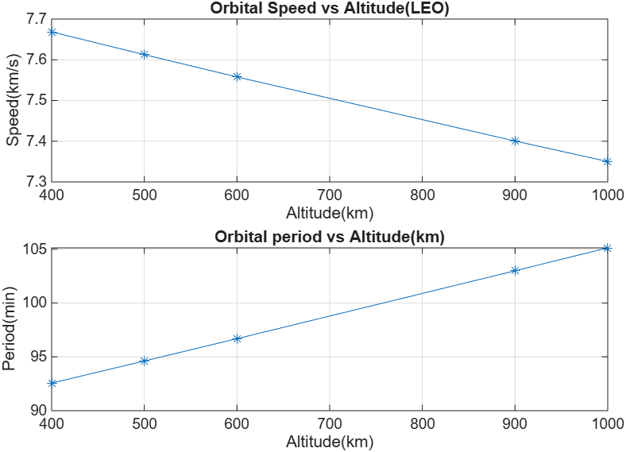
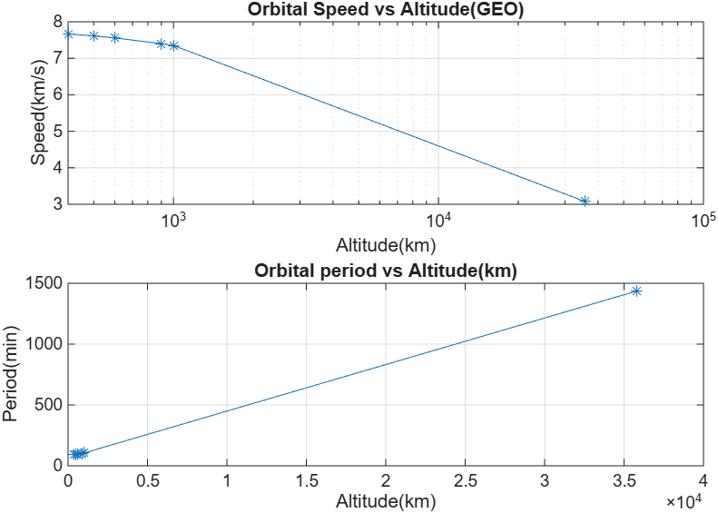
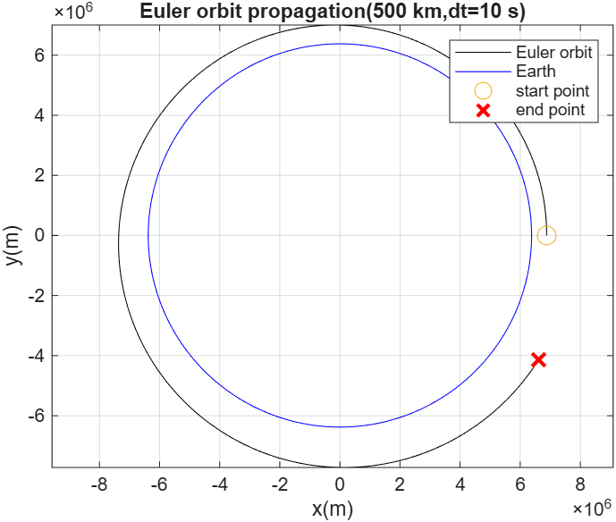
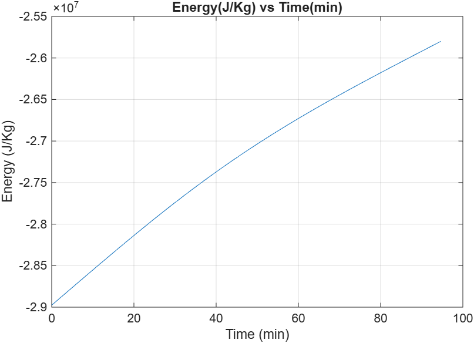
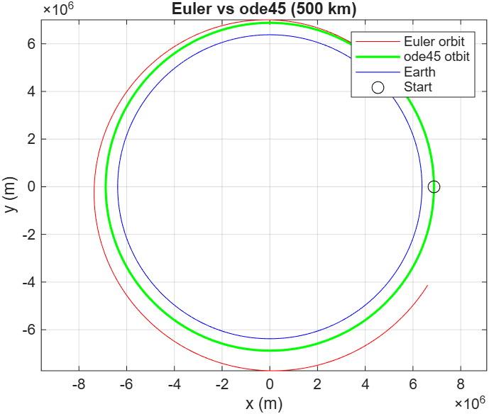
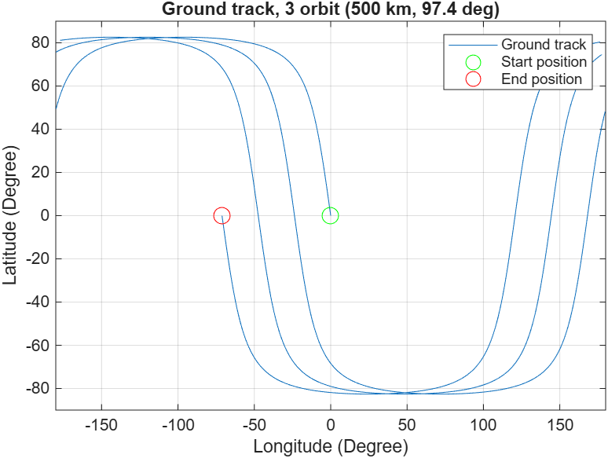
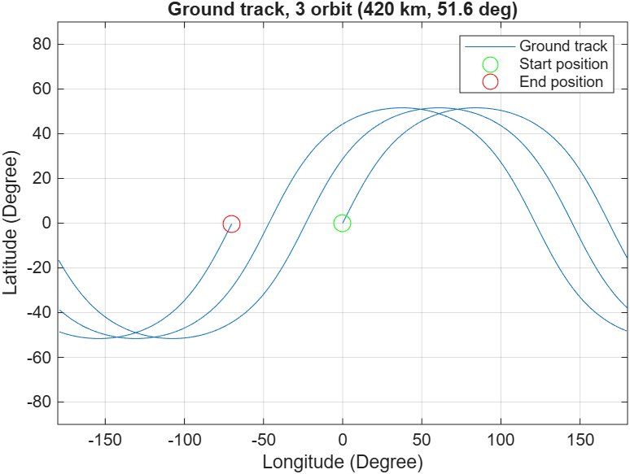
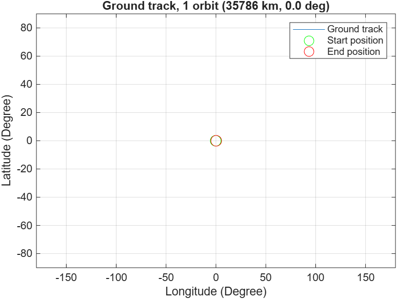
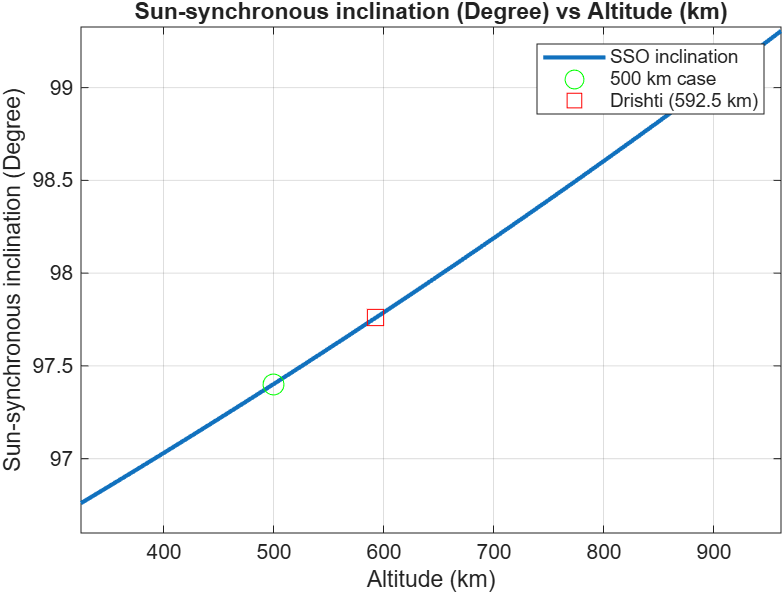

# Two-Body Orbital Dynamics Simulation and Orbit Characterization of LEO and GEO Satellites in MATLAB

A MATLAB project that characterises circular Earth orbits analytically, propagates them numerically (hand-written Euler against `ode45`), draws ground tracks on a rotating Earth, and designs a sun-synchronous orbit using J2 precession. The sun-synchronous result is checked against the published orbit of an Earth-observation satellite.

**Status:** all four stages complete.

## Contents

| File | Purpose |
|---|---|
| `orbit_stage1.m` | Analytical orbital speed, period and orbits per day for LEO to GEO, with validation |
| `orbit_stage2.m` | Euler and ODE45 orbit propagation, error and energy analysis (the `ode45` equations of motion are a local function at the end of the script) |
| `orbit_stage3.m` | 3D circular orbit with inclination and ground track on a rotating Earth |
| `orbit_stage4.m` | J2 nodal precession, sun-synchronous inclination, ground-track spacing, swath and revisit estimate |
| `results/` | Figures and output screenshots produced by the scripts |

Run each `orbit_stageN.m` directly; each script is self-contained. Tested workflow: MATLAB Online, no toolboxes required. Stage 2 changes the time step by editing `dt` in its setup block, and Stage 3 changes case by editing the four lines under "Case settings".

## Theory

For a circular two-body orbit of radius r = Re + altitude, gravity supplies the centripetal force:

- Orbital speed: **v = sqrt(mu / r)**
- Orbital period: **T = 2 pi sqrt(r^3 / mu)**

where mu = GM = 3.986004418 x 10^14 m^3/s^2 and Re = 6378.137 km.

For propagation, the satellite state [x, y, vx, vy] evolves under **a = -mu r_vec / |r|^3**, and the specific orbital energy **E = v^2/2 - mu/r** should stay constant for an ideal circular orbit. Radius growth and energy drift are used as error measures.

Earth's equatorial bulge (J2 = 1.08263 x 10^-3) makes the orbit plane precess. For a circular orbit:

- **dOmega/dt = -1.5 J2 (Re / r)^2 n cos(i)**

where n = sqrt(mu / r^3) and i is the inclination. A sun-synchronous orbit needs this rate to equal one turn per tropical year, 2 pi / (365.2422 x 86400) rad/s = 0.9856 deg/day, which requires a retrograde inclination (i > 90 deg).

## Stage 1: analytical orbit characterisation

| Altitude (km) | Speed (km/s) | Period (min) | Orbits/day |
|---|---|---|---|
| 400 | 7.669 | 92.56 | 15.56 |
| 500 | 7.613 | 94.62 | 15.22 |
| 600 | 7.558 | 96.69 | 14.89 |
| 900 | 7.400 | 102.99 | 13.98 |
| 1000 | 7.350 | 105.12 | 13.70 |
| 35786 (GEO) | 3.075 | 1436.07 | 1.00 |

**Validation:** the computed GEO period is compared with the sidereal day (23 h 56 min 4 s = 1436.07 min). The error is **1.1 x 10^-5 %**, confirming the formulas, constants and unit handling.

## Stage 2: numerical propagation (500 km, one orbit)

Euler propagation with dt = 10 s:

Specific energy should be constant but rises under Euler:

Euler against `ode45` (RelTol 1e-9, AbsTol 1e-6):

| Method | Radius growth after one orbit |
|---|---|
| Euler, dt = 10 s | 920.0 km (13.38 %) |
| `ode45` | 0.000004 km (about 4 mm) |

### Time-step study (Euler)

Obtained by running `orbit_stage2.m` three times with `dt` set to 60, 10 and 1 s.

| dt (s) | Radius growth (km) | Energy change (%) |
|---|---|---|
| 60 | 5200.4 | 35.99 |
| 10 | 920.0 | 10.96 |
| 1 | 95.1 | 1.35 |

**Findings**

- Euler's error scales roughly linearly with dt, consistent with a first-order method. A tenfold reduction in dt (10 s to 1 s) reduced the radius error by about 9.7x and the energy error by about 8x.
- Each Euler step lands slightly outside the true circle, so the orbit gains energy and spirals outward. A larger orbit has a longer period, so the satellite does not return to its starting point after one nominal period.
- Even with dt = 1 s (about 5,700 steps) Euler is still about 95 km off, whereas `ode45` is accurate to millimetres. Reducing the step size alone is an inefficient way to gain accuracy.

## Stage 3: ground track on a rotating Earth

For a circular orbit the angle along the orbit is u = n t. The position is tilted by the inclination, converted to latitude and inertial longitude, and then the Earth's rotation (7.2921159 x 10^-5 rad/s x t) is subtracted from the longitude. Longitude is wrapped to -180 to 180 deg, and the plot line is broken at the wrap so no false horizontal lines appear.

| Case | Altitude | Inclination | Orbits | max(lat) | lon(end) | Wrap jumps |
|---|---|---|---|---|---|---|
| Sun-synchronous | 500 km | 97.4 deg | 3 | 82.60 deg | -71.14 deg | 3 |
| ISS-like | 420 km | 51.6 deg | 3 | 51.60 deg | -70.09 deg | 3 |
| Geostationary | 35786 km | 0 deg | 1 | 0.00 deg | about 0 deg | 0 |

**Findings**

- Earth turns about 23.7 deg during one orbit at 500 km, so each pass lands about 24 deg west of the previous one. Over three orbits the end point is about 71 deg west of the start.
- A GEO satellite's ground track is a single fixed point, because its orbital rate equals Earth's rotation rate.
- The maximum latitude equals the inclination for a prograde orbit (51.6 deg for the ISS-like case) and 180 deg minus the inclination for a retrograde orbit (82.6 deg at 97.4 deg).

## Stage 4: sun-synchronous orbit, J2 and coverage

### Required precession and sun-synchronous inclination

The required precession rate is 1.9911 x 10^-7 rad/s (0.9856 deg/day). Solving the J2 expression for cos(i) gives the inclination for each altitude:

At 500 km the sun-synchronous inclination is **97.40 deg**. The inclination rises from about 96.7 deg at 300 km to about 99.5 deg at 1000 km, because J2 precession weakens with altitude and the orbit must tilt further retrograde to keep turning at 0.9856 deg/day.

### Comparison with a published Earth-observation orbit

GalaxEye's Drishti (OptoSAR) satellite is reported in public sources at about 592 km and 97.74 deg inclination, with swaths of about 10 km (optical) and 30 km (SAR). Public sources differ on its altitude (one gives about 500 km); the 592.5 km value was used because it comes with the inclination. These figures are from public sources, not from GalaxEye, and this is an independent student project.

| Quantity | 500 km baseline | 592.5 km (Drishti-like) |
|---|---|---|
| SSO inclination (computed) | 97.40 deg | 97.76 deg (published: 97.74 deg) |
| J2 precession at inclination used | 0.9854 deg/day | 0.9833 deg/day |
| Ground-track shift per orbit | 23.72 deg (2640 km) | 24.20 deg (2694 km) |
| Orbits per day | 15.22 | 14.92 |
| Days to cover the equator, optical (10 km) | 263 | 269 |
| Days to cover the equator, SAR (30 km) | 88 | 90 |

The sun-synchronous inclination plot above marks both the 500 km baseline and the Drishti-like point (592.5 km).

**Findings**

- The sun-synchronous inclination computed at 592.5 km (97.76 deg) is within 0.02 deg of the published value (97.74 deg).
- Precession is sensitive to inclination. At the published 97.74 deg the rate is 0.9833 deg/day rather than 0.9856, which would slowly drift the local pass time over a year. Real satellites correct for this with small manoeuvres.
- A single satellite looking straight down covers the equator slowly (about 90 to 270 days for these swaths, best case). This motivates off-nadir pointing and constellations.

The coverage time is calculated as equator length / (orbits per day x swath). It assumes passes pack side by side with no overlap, a single satellite, nadir pointing only, and counts one pass direction.

## Assumptions and limitations

- Two-body problem: Earth and satellite only; point-mass gravity in the propagation (Stage 2)
- J2 is used only in the analytical precession formula; the Stage 2 propagation and Stage 3 ground track do not include it
- Circular orbits; Stage 2 is planar (2D)
- No atmospheric drag, solar radiation pressure or third-body effects
- Spherical Earth for ground-track geometry; no geodetic latitude correction
- Swath widths and the Drishti orbit come from public sources and have not been verified with the operator
- Coverage estimate is a simplified best case, not a revisit simulation

## Roadmap

- [x] Stage 1: analytical period and speed, validation
- [x] Stage 2: Euler and ODE45 propagation, energy and time-step study
- [x] Stage 3: 3D orbit with inclination and ground track on a rotating Earth
- [x] Stage 4: J2 precession, sun-synchronous inclination, swath and revisit estimate
- [ ] Future: drag, eccentric orbits, SGP4 with real TLE data, off-nadir access analysis

## License

MIT
